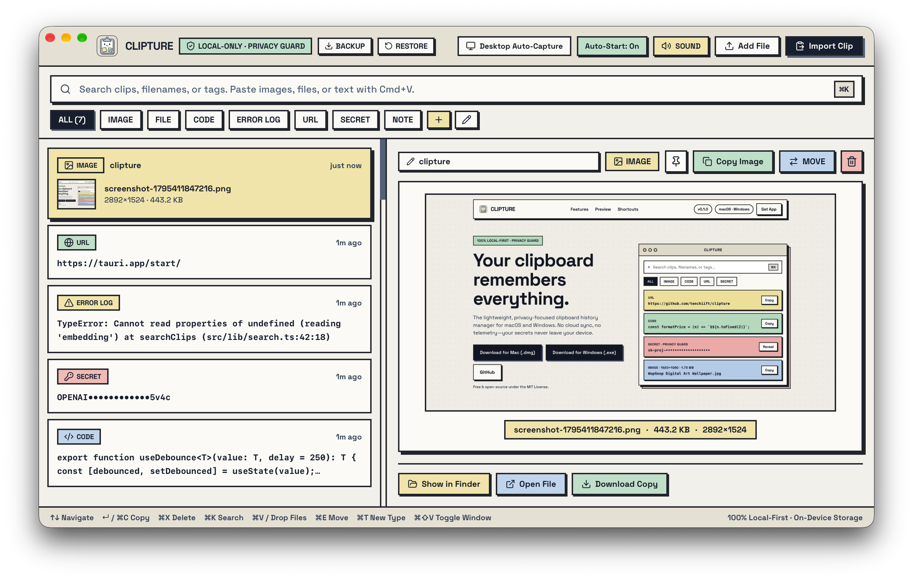

<p align="center">
  
</p>

<h1 align="center">Clipture</h1>

<p align="center">
  <em>Your clipboard remembers everything. Your secrets never leave your Mac.</em>
</p>

<p align="center">
  <code>Tauri 2</code> &nbsp;·&nbsp;
  <code>Rust</code> &nbsp;·&nbsp;
  <code>React 19</code> &nbsp;·&nbsp;
  <code>TypeScript</code> &nbsp;·&nbsp;
  <code>Tailwind v4</code> &nbsp;·&nbsp;
  <code>100% Local-First</code> &nbsp;·&nbsp;
  <code>MIT License</code>
</p>

---

<p align="center">
  
</p>

Most clipboard managers either forget everything after a reboot or quietly sync your `.env` keys, stack traces, and screenshots to someone else's server.

**Clipture** keeps your clipboard history fast, searchable, and strictly on-device in a lightweight **Tauri + Rust** desktop app (~3.9 MB `.dmg` / ~12 MB `.app`). Every clip is classified locally into `Code`, `Error Log`, `URL`, `Secret`, `Image`, `File`, or `Note` (plus custom clip types), while **Privacy Guard** automatically detects and masks API keys, tokens, and sensitive strings before anything can leave your machine.

## What's New in v0.3.0

- **Quick Cursor Popup (`⌥⌘V` / `Ctrl+Alt+V`)**: Pull up your recent clips right next to your cursor with smooth spring-like appear/dismiss motion and instant search—without bringing the main window to the front.
- **Native Drag & Drop**: Drag text, URLs, images, and files directly from the main window or Quick Cursor Popup into Finder, browsers, Discord, or editors, with compact `44×44` image drag previews.
- **Custom Global Shortcuts**: Rebind your **Show / Hide Clipture** and **Quick Cursor Popup** shortcuts anytime from the menu bar tray (`Custom Shortcuts...`).
- **Flexible Clip Types & Privacy Guard**: Create multiple custom folders mapped to built-in types (`TYPES:`), mask all items inside `secret`-typed folders, and clear all clips in one click with **Clear All**.
- **Fast & Reliable Storage**: Preloads disk-backed clips (`< 50 MB` per capture) with zero startup flicker, plus full text, media, and custom-type backup/restore.

## Install

No Node.js or `npm` required.

1. Download the latest installer from **Releases** (`.dmg` for macOS, `.exe` for Windows).
2. **macOS**: Open the `.dmg`, drag **Clipture** into **Applications**, and launch it. On first run, if macOS Gatekeeper asks, right-click **Clipture.app** and click **Open**.

## Features

- **Background auto-capture**: Text, syntax-highlighted `Code` snippets (with Dark & White mode), screenshots, and macOS Finder files are captured locally in the background.
- **Privacy Guard**: Automatically detects and masks API keys, tokens, and sensitive credentials.
- **Custom clip types & drag-to-reorder**: Create custom clip types (`⌘T`), restore built-in templates, drag to reorder categories, move clips (`⌘E`), and add custom titles/remarks.
- **Backup & Restore**: Export/import local JSON backups (with 5 MB per-file check).
- **Menu bar tray & shortcut priority**: Lives in your macOS menu bar with **Prioritize Clipture Shortcuts** to override clashing macOS shortcuts.

## Keyboard Shortcuts

| Shortcut | Action |
| --- | --- |
| `↑` / `↓` | Move through clip history |
| `↵` / `⌘C` (`Win+C`) | Copy selected clip to clipboard |
| `⌘X` (`Win+X`) | Delete selected clip (with confirmation) |
| `⌘K` (`Win+K`) | Focus search bar |
| `⌘V` / Drop | Import text, images, or files |
| `⌘E` (`Win+E`) | Move selected clip to another clip type |
| `⌘T` (`Win+T`) | Create custom clip type |
| `⌘⇧V` (`Win+Shift+V`) | Toggle desktop window |
| `⌥⌘V` (`Ctrl+Alt+V`) | Toggle Quick Cursor Popup (customizable) |
| `Esc` | Cancel mode, close popup, or clear search query |

## Run from Source (Developers)

Requires **Node.js** and **Rust** (`rustup`).

```bash
npm install
npm run dev:tauri
```

Other scripts:

```bash
npm run dev           # Start Vite web dev server
npm run build         # Type-check and build frontend bundle (dist/)
npm run build:tauri   # Build native Tauri .app / .dmg / .exe
npm run lint          # Run ESLint
```

## Project Structure

```text
clipture/
├── src-tauri/         # Rust backend (clipboard watcher, tray, global shortcuts, media storage)
├── src/
│   ├── assets/        # App icon
│   ├── components/    # QuickDrawer (Quick Cursor Popup)
│   ├── hooks/         # useClipboardAdapter (Desktop + Web fallback)
│   ├── lib/           # desktop-bridge, drag-icon, local classifier, syntax highlighter, Privacy Guard
│   ├── types/         # ClipItem & media payload types
│   ├── App.tsx        # Main split-pane interface & keyboard navigation
│   └── index.css      # Theme tokens, drawer animations & accessibility rules
├── docs/              # Landing page & preview assets
└── package.json
```

## License

[MIT](LICENSE)
